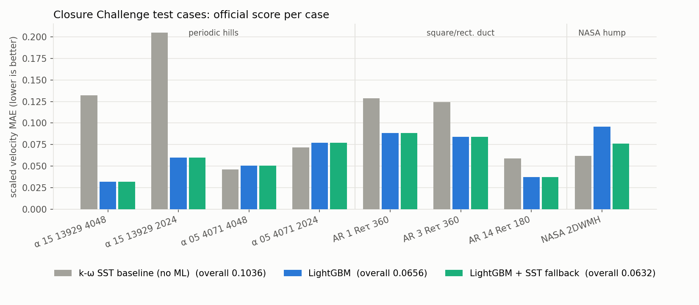
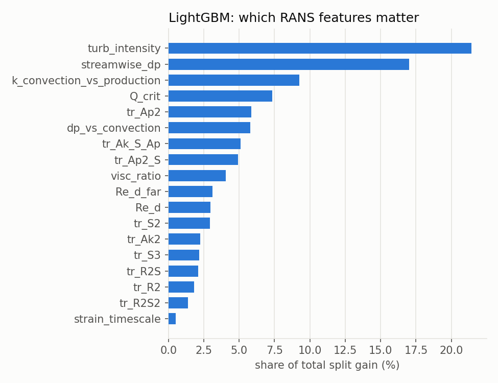

# Machine-learning corrections for RANS turbulence models: Closure Challenge

Practice project on [**The Closure Challenge**](https://github.com/rmcconke/ml-turbulence-benchmark),
an open benchmark for machine learning in Reynolds-averaged Navier–Stokes (RANS) turbulence
modelling ([McConkey et al., 2026, arXiv:2603.28884](https://doi.org/10.48550/arXiv.2603.28884)).

Two models learn to correct the velocity field predicted by the standard k-ω SST turbulence
model, using the same inputs, targets and data so that they can be compared directly:

* **Model 1: gradient-boosted trees (LightGBM)**
* **Model 2: a neural network (PyTorch multi-layer perceptron)**

Both are scored with the **official `closure_challenge` package** on the benchmark's held-out
test cases. The best variant, **the neural network with an SST fallback, scores 0.0595**. That
is level with 2nd place on the public leaderboard at four decimals (see the caveat below).

## Results

<!-- SCORES -->
| Model | **Overall** | alpha_15_13929_4048 | alpha_15_13929_2024 | alpha_05_4071_4048 | alpha_05_4071_2024 | AR_1_Ret_360 | AR_3_Ret_360 | AR_14_Ret_180 | NASA_2DWMH |
|---|---|---|---|---|---|---|---|---|---|
| k-ω SST baseline (no ML) | **0.1036** | 0.1320 | 0.2049 | 0.0461 | 0.0719 | 0.1288 | 0.1243 | 0.0590 | 0.0621 |
| LightGBM | **0.0656** | 0.0322 | 0.0602 | 0.0505 | 0.0770 | 0.0883 | 0.0839 | 0.0373 | 0.0959 |
| LightGBM + SST fallback | **0.0632** | 0.0322 | 0.0602 | 0.0505 | 0.0770 | 0.0883 | 0.0839 | 0.0373 | 0.0761 |
| MLP | **0.0661** | 0.0363 | 0.0473 | 0.0417 | 0.0721 | 0.0820 | 0.0772 | 0.0318 | 0.1402 |
| MLP + SST fallback | **0.0595** | 0.0363 | 0.0473 | 0.0417 | 0.0721 | 0.0820 | 0.0772 | 0.0318 | 0.0873 |

| Rank | Entry | Overall score |
|---|---|---|
| 1 | Yang | 0.0580 |
| 2 | **MLP + SST fallback (this repo)** | 0.0595 |
| 3 | Reissmann, Fang, Sandberg | 0.0595 |
| 4 | Wu and Zhang | 0.0624 |
| 5 | **LightGBM + SST fallback (this repo)** | 0.0632 |
| 6 | Tian, Buchanan, Hickel, Dwight | 0.0641 |
| 7 | **LightGBM (this repo)** | 0.0656 |
| 8 | **MLP (this repo)** | 0.0661 |
| 9 | Liu, Wang, Zhao, Xiao | 0.0737 |
| 10 | Montoya, Oulghelou, Cinnella | 0.0779 |
| 11 | k-ω SST baseline (no ML) | 0.1036 |
<!-- /SCORES -->



The leaderboard entries above come from the [benchmark README](https://github.com/rmcconke/ml-turbulence-benchmark#current-leaderboard).
**This is not a like-for-like comparison.** Most entries learn a turbulence *closure* and re-solve
RANS with it. These models correct the velocity field directly, as a post-hoc step. The challenge
rules allow that, but it is an easier task.

---

## 1. What is the Closure Challenge?

RANS solvers are the workhorse of engineering CFD. They solve for the *mean* flow, but averaging
leaves an unknown term, the **Reynolds stress**, that must be approximated by a turbulence model
(the "closure"). Models like k-ω SST are cheap but inaccurate in separated flows and duct corners.
Many papers have tried to learn better closures from high-fidelity simulations, but each used its
own data and metric. The Closure Challenge provides:

* **Standardised data.** For every case: the mesh, the k-ω SST RANS solution, and DNS/LES "truth"
  interpolated onto the same cells (OpenFOAM format).
* **A fixed split that tests generalisation.** New hill shapes, a higher Reynolds number and a
  wider aspect ratio for the duct, and the **NASA wall-mounted hump**, a geometry absent from
  training.
* **One metric.** `mean‖U_pred − U_true‖ / mean‖U_true‖` at 1 000 fixed points per test case,
  averaged over 8 test cases. Lower is better.
* **One strict rule.** Never train or validate on test-case data.

| Flow | Train | Validation | Test |
|---|---|---|---|
| Periodic hills (29 shapes) | 21 shapes | 4 shapes | 4 shapes |
| Square/rect. duct | AR 1, 3, 5, 10 @ Re<sub>τ</sub> 180 | AR 7 | AR 1, 3 @ Re<sub>τ</sub> 360; AR 14 @ 180 |
| Curved backward-facing step | ✓ | | |
| Periodic hills Re = 10 595 | ✓ | | |
| NASA wall-mounted hump | | | ✓ |

## 2. Data

Each case is the same flow simulated twice: a **cheap k-ω SST RANS** run (model input, found in the
last time folder) and an **expensive LES/DNS** run (the training target, in `0/U_LES`). The
high-fidelity data comes from Xiao et al. (parametric hills), Vinuesa et al. (ducts), NASA TMR
(hump, curved step) and Breuer et al. (hills at Re = 10 595). Every mesh cell is one training row:
**~406 000 training rows, ~78 000 validation rows.**

## 3. Method

1. **Gradients and wall distance** of the RANS fields, computed from the OpenFOAM mesh
   (least squares; [`src/ccml/mesh.py`](src/ccml/mesh.py)).
2. **18 dimensionless, frame-invariant input features** from the RANS solution only: tensor
   invariants of strain/rotation rate and ∇k, ∇p, plus turbulence intensity, Q-criterion,
   wall-distance Reynolds number, streamwise pressure gradient and others
   ([`src/ccml/features.py`](src/ccml/features.py)). Because they are dimensionless and don't
   depend on the coordinate system, a model trained on hills and ducts can be applied to a new
   geometry.
3. **Target = RANS error** `U_LES − U_RANS`, written in a local flow-aligned frame
   (streamwise / wall-normal / cross-stream) and scaled by a local velocity √(|U|²+2k).
4. **Every case weighted equally**, so the 21 hill cases don't swamp the 4 ducts.
5. **Two interchangeable models** sit in the middle of this pipeline (see the next section).
6. Prediction: `U = U_RANS + scale × correction`, sampled at the official evaluation points.

### The two models

| | Model 1: LightGBM | Model 2: MLP |
|---|---|---|
| Script | [`train_lightgbm.py`](scripts/train_lightgbm.py) | [`train_mlp.py`](scripts/train_mlp.py) |
| What it learns | Step-like if/then rules (decision trees), added one at a time | A smooth function with 43,907 weights |
| Architecture | One booster per output component; 31 leaves, ≥200 cells per leaf | 18 → 128 → 128 → 128 → 64 → 3, SiLU activations |
| Training | Huber loss, learning rate 0.03, 80% row/feature subsampling | Huber loss, AdamW (lr 2·10⁻³, cosine decay), batches of 1 024, 60 epochs |
| Input scaling | Not needed | Standardised with training-set mean/std, clipped at ±10 |
| Overfitting control | Early stopping on validation cases | Keep the epoch with the best validation loss |

## 4. Findings

**LightGBM rediscovered where SST fails.** Its most important features are turbulence intensity
(21%) and streamwise pressure gradient (17%). Separation is driven by adverse pressure gradients
in highly turbulent regions, which is exactly where k-ω SST is known to be wrong.



**Both interpolate well, and neither can extrapolate.** Errors drop sharply on hill shapes and duct
aspect ratios similar to the training data. Here the neural network is the stronger of the two:
its smooth output suits smooth flow fields better than trees' step-like rules. On the
**NASA hump**, however, both models are *worse* than plain SST, and the neural network is the
worst. Given inputs it has never seen, a tree model outputs the nearest value it knows, while a
network keeps extending its learned curves. [`scripts/check_ood.py`](scripts/check_ood.py) shows why. In 34% of the hump's cells at least
one input feature lies beyond anything seen in training; for every other test case that figure is
0%. Using a looser definition (outside the central 99% of training values), it is 64% of hump cells
against 5–14% elsewhere. The model is guessing there.

**Fix: an SST fallback.** With `--fallback`, the model's correction is applied only where every
feature lies within the training min/max. Elsewhere the plain SST velocity is kept. This leaves
every other test case unchanged and recovers most of the hump's accuracy for both models. The
neural network gains the most, going from 0.0661 to **0.0595** overall. The
cutoff was fixed *before* looking at the test scores. Tuning it on the test set would amount to
training on test data, and the validation set contains no new geometry to tune it on. The fallback was motivated by the hump result itself, so its benefit on that case should be treated as optimistic.

## 5. Reproduce (Windows / macOS / Linux)

```bash
pip install -r requirements.txt
git clone --depth 1 https://github.com/rmcconke/ml-turbulence-benchmark   # ~1 GB
python scripts/build_dataset.py  --data ml-turbulence-benchmark/data       # features -> cache/
python scripts/make_baseline.py  --points ml-turbulence-benchmark/data/evaluation_points
python scripts/train_lightgbm.py --points ml-turbulence-benchmark/data/evaluation_points
python scripts/train_lightgbm.py --points ml-turbulence-benchmark/data/evaluation_points --fallback --out submissions/lightgbm_ood
python scripts/train_mlp.py      --points ml-turbulence-benchmark/data/evaluation_points
python scripts/train_mlp.py      --points ml-turbulence-benchmark/data/evaluation_points --fallback --out submissions/mlp_ood
python scripts/check_ood.py
python scripts/score.py                                                     # official scores, README table, figures
```

If `git clone` fails partway through, download the
[ZIP](https://github.com/rmcconke/ml-turbulence-benchmark/archive/refs/heads/main.zip) instead and
rename the extracted folder to `ml-turbulence-benchmark`. Results vary slightly between machines
(about ±0.001 for LightGBM and more for the MLP). Windows and Linux order the training files
differently, which changes the mini-batches the network sees. The training takes a few minutes per
model on a laptop CPU.

`submissions/<model>/` holds CSVs in the exact format the challenge accepts.

## 6. Ideas for next steps

* **Learn the closure instead of the velocity.** Predict the Reynolds-stress anisotropy (e.g. a
  tensor-basis neural network) or a corrected eddy viscosity, then re-solve RANS in OpenFOAM. The
  result would satisfy the flow equations and be directly comparable with the leaderboard.
* **Softer fallback.** Blend smoothly between model and SST according to how far a cell lies
  outside the training range, rather than switching abruptly.
* **Ensembles and seeds.** Average both models; report the spread over several random seeds.
* **3-D cases.** Add the wing-body junction, Ahmed body and FAITH hill linked in the benchmark.

## Repository layout

```
src/ccml/   foam_io.py  OpenFOAM readers        mesh.py   gradients, wall distance
            features.py features & targets      cases.py  train/val/test split
            data.py     loading, metric, submission writer
            models.py   MLP definition, model loaders
scripts/    build_dataset · make_baseline · train_lightgbm · train_mlp · check_ood · score
submissions/ results/ models/
```

## Citation

McConkey, Buchanan, Smidt, Bodner, Dwight & Cinnella, *The Closure Challenge: a benchmark task
for machine learning in turbulence modelling*, arXiv:2603.28884 (2026). Original datasets are
credited in the [benchmark README](https://github.com/rmcconke/ml-turbulence-benchmark).
